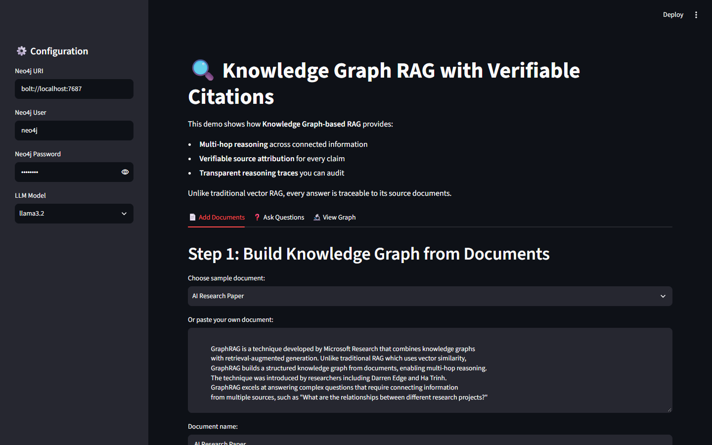
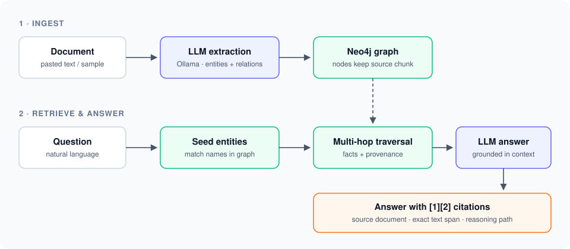

# Knowledge Graph RAG with Citations

A Streamlit app that answers questions over your documents using a **knowledge graph** instead of plain vector search. Every claim in an answer links back to the source text it came from.

Standard vector RAG retrieves similar chunks, so it struggles when an answer depends on facts spread across several documents. This project extracts entities and relationships into Neo4j, walks the graph to collect connected facts (multi-hop reasoning), and keeps provenance on every node and edge so the final answer can cite its sources.

Runs fully local: **Ollama** for the LLM, **Neo4j** for the graph.



## Features

- **Multi-hop reasoning**: follows entity relationships across documents to answer compound questions
- **Verifiable citations**: each `[n]` in the answer maps to a source document and the exact text span
- **Reasoning trace**: shows which entities and relationships were traversed to build the answer
- **Local and private**: no API keys, no data leaves your machine
- **Docker Compose**: one command brings up Neo4j, Ollama and the app

## How it works



1. **Ingest**: the LLM extracts entities (people, orgs, concepts, technologies) and typed relationships from each chunk. Each one is stored with its source document and chunk ID.
2. **Retrieve**: entities mentioned in the question seed a graph traversal that pulls in connected facts.
3. **Answer**: the LLM writes an answer using only the retrieved context and cites each claim.

## Tech stack

| Layer | Tool |
|-------|------|
| UI | Streamlit |
| LLM | Ollama (`llama3.2` by default) |
| Graph DB | Neo4j 5 |
| Packaging | Docker, Docker Compose |

## Quick start

### Option A: Docker Compose (recommended)

```bash
git clone https://github.com/Khushipatel27/knowledge-graph-rag-citations.git
cd knowledge-graph-rag-citations
docker compose up --build
```

Then open http://localhost:8501. The Neo4j browser is at http://localhost:7474 (user `neo4j`, password `password`). The first start pulls `llama3.2`, which takes a few minutes.

> Inside Docker, set **Neo4j URI** in the sidebar to `bolt://neo4j:7687`. The app reads it from the sidebar, not from env vars.

### Option B: Run locally

Prerequisites: Python 3.9+, [Ollama](https://ollama.com), and a running Neo4j instance.

```bash
# 1. Pull the model
ollama pull llama3.2

# 2. Start Neo4j (any one of these)
docker run -d --name neo4j -p 7474:7474 -p 7687:7687 \
  -e NEO4J_AUTH=neo4j/password neo4j:latest
#    or Neo4j Desktop (local DB on bolt://localhost:7687)
#    or a free Neo4j AuraDB instance (use its neo4j+s://... URI in the sidebar)

# 3. Install and run
python -m venv .venv
source .venv/bin/activate        # Windows: .venv\Scripts\activate
pip install -r requirements.txt
streamlit run knowledge_graph_rag.py
```

Open http://localhost:8501, check the Neo4j settings in the sidebar, then:

1. **Add Documents**: pick a sample document (or paste your own) and click **Extract & Add to Knowledge Graph**.
2. **Ask Questions**: type a question and click **Ask with Citations**.
3. **View Graph**: see entity and relationship counts.

## Configuration

| Setting | Default | Where |
|---------|---------|-------|
| Neo4j URI | `bolt://localhost:7687` | sidebar |
| Neo4j user | `neo4j` | sidebar |
| Neo4j password | `password` | sidebar |
| Model | `llama3.2` (also `mistral`, `phi3`) | sidebar |
| Ollama host | `http://localhost:11434` | `OLLAMA_HOST` env var |

## Example

```
Document:  "GraphRAG was developed by Microsoft Research. Darren Edge led the project..."

Extracted: GraphRAG (TECHNOLOGY), Microsoft Research (ORGANIZATION), Darren Edge (PERSON)
           Darren Edge --[WORKS_FOR]--> Microsoft Research

Question:  "Who developed GraphRAG and what organization are they from?"

Answer:    GraphRAG was developed at Microsoft Research [1], with Darren Edge leading the project [2].
           [1] AI Research Paper: "GraphRAG is a technique developed by Microsoft Research..."
           [2] AI Research Paper: "...introduced by researchers including Darren Edge..."
```

## Project structure

```
knowledge-graph-rag-citations/
├── knowledge_graph_rag.py   # Streamlit app: KnowledgeGraphManager, extraction, cited answering
├── requirements.txt
├── Dockerfile
├── docker-compose.yml       # Neo4j + Ollama + app
└── assets/                  # screenshot + architecture diagram
```

Key pieces in `knowledge_graph_rag.py`:

- `KnowledgeGraphManager`: Neo4j reads and writes, graph traversal
- `extract_entities_with_llm()`: entity and relationship extraction with provenance
- `generate_answer_with_citations()`: multi-hop retrieval and cited answer generation

## Possible next steps

- PDF and URL ingestion
- Hybrid retrieval (vector search to pick seed entities, graph for expansion)
- Interactive graph visualization of the reasoning path

## Acknowledgements

Built on the Knowledge Graph RAG example from [awesome-llm-apps](https://github.com/Shubhamsaboo/awesome-llm-apps), with ideas from [VeritasGraph](https://github.com/bibinprathap/VeritasGraph).

## License

Apache 2.0. See [LICENSE](LICENSE).
